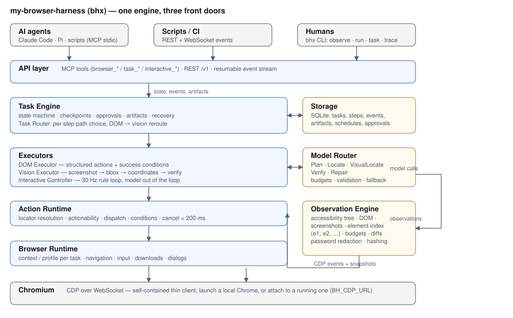

# my-browser-harness（二进制 `bhx`）

**面向 AI Agent 的浏览器执行基础设施（Browser Harness）。**

它不替 Agent 思考，而是替 Agent 把「观察 → 定位 → 操作 → 验证 → 恢复」这件事做稳。
游戏只是它的一种负载，不是它的定义。

```
AI Agent   ──►   bhx Harness   ──►   Chromium (CDP)
 （想清楚）        （跑得稳）          （真实浏览器）
```

**English** · [中文](README.zh-CN.md) · [文档](docs/README.md) ·
[参与贡献](CONTRIBUTING.md) · [安全](SECURITY.md) · [变更记录](CHANGELOG.md)

---

Browser Agent 每一步都重新读页面、每一步都问一次模型；Browser Harness 反过来：
计划一次性编译成声明式任务，执行阶段零模型调用，每个动作自带成功条件。
产出因此是可定时跑、可对比、可回放、可审计的东西，而不是「希望它成功了」。

```bash
python3 testkit/server.py --port 8766 &        # 本地测试站点
./target/release/bhx task run testkit/sites/admin/task.json \
    --cred username=admin --cred password=admin123     # 登录 → 筛选 → 导出 CSV
# SUCCEEDED in 706 ms  (task 01M65XT9X1…)
#   s1         succeeded  verified=true 113 ms
#   s2         succeeded  verified=true  40 ms
#   s3         succeeded  verified=true  35 ms
# $ bhx task show <task-id> --json | jq .model_calls
# 0
```

最后那行才是重点：一个带登录、服务端筛选、导出 CSV 的三步任务，逐步验证，
**模型调用 0 次**。上面是真实输出，不是示意
（测量记录见 [docs/benchmarks.md](docs/benchmarks.md)）。

## 三个核心价值

| 价值 | 含义 | 对应能力 |
|---|---|---|
| 工作能力 | 可靠完成多步骤网页任务，产出文件与数据 | Task Engine + DOM Executor |
| 执行能力 | 同一任务可走 DOM、视觉或混合路径 | Task Router + Vision Executor |
| 实时能力 | 模型不在线时，也能按已批准的策略连续动作并反馈调整 | Interactive Controller |

由此展开的能力：

- **任务可持久化**：SQLite 状态机、每步检查点、不可逆动作审批、产物索引、崩溃恢复
  （`kill -9` 后 `task resume` 只重跑被打断的那一步）。
- **三个入口，同一个引擎**：CLI（`bhx`）、给 Agent 用的 MCP stdio 服务、
  REST + WebSocket（事件流可断线续传）。
- **模型层是能力契约，不是提示词**：`Plan` / `Locate` / `VisualLocate` / `Verify` /
  `Repair` 都是带类型的接口，前面有路由器做每任务调用预算、提案校验与降级链。
  任何 OpenAI 兼容端点都能接；本地决策模型走 sidecar。没配适配器就明确失败，
  不会偷偷退回猜坐标。
- **可证明**：`bhx stats` 从存储复算成功率、耗时分位数、失败动作率；
  `bhx trace` 输出自包含的 trace 包，里面的 `trace.html` 是单文件回放器。
- **可定时**：`bhx schedule add task.json --every 30m`，凭据在库里只存名字，
  运行时从环境变量取值。

## 实测数字

在 Apple M5 笔记本上、对本机测试站点测得（完整记录见 [docs/benchmarks.md](docs/benchmarks.md)）：

| 项 | 结果 |
|---|---|
| CDP 往返 | 0.1–0.5 ms |
| 单动作 p95 | 17.2 ms（其中 97% 是一次 `mouseMoved`） |
| 真实工作流连续 3 次（`bhx run`，debug 构建） | 202 / 271 / 218 ms，**0 次模型调用** |
| 同一任务作为持久任务（`bhx task run`，release 构建） | 暖机 591–774 ms，冷启动 ~1.4 s，**0 次模型调用** |
| 取消生效 | 85 ms，且无残留按键 |
| 交互控制器 30 s 浸泡 | 909 tick，tick p95 34 ms，CPU 3.6% |
| 视觉路径拖拽落点误差 | 0.57–0.70 px（要求 ≤ 4 px） |
| 跨 Agent 验收 | Claude Code 10 s、Pi + 本地 Qwen 16–22 s，导出 CSV 同哈希 |

## 环境要求

- Rust 1.89+（edition 2024；开发用 1.93）——`rusqlite` 要求 1.89，更低版本连依赖都解析不过
- Google Chrome 或 Chromium；不在默认路径时用 `BH_CHROME=/path/to/chrome`
- Python 3（只用标准库）——测试站点与验收套件
- 没有云服务：Harness 自己启动本地 Chrome，或用 `BH_CDP_URL` 连一个已在运行的

## 构建与上手

```bash
cargo build --release
./target/release/bhx --help

# 看页面：输出元素索引（e1, e2…）与状态文本
./target/release/bhx observe --url https://example.com

# 跑步骤脚本：登录 → 筛选 → 导出 CSV（跑完即走，不落任务状态）
./target/release/bhx run testkit/sites/admin/task.json

# 作为任务跑：落 SQLite、检查点、产物、审批，可中断可恢复
./target/release/bhx task run testkit/sites/admin/task.json

# 运行历史与 trace：数字从存储复算，trace.html 直接双击就能看
./target/release/bhx task ls
./target/release/bhx stats
./target/release/bhx trace <task-id> --out ./trace-<task-id>

# 作为 MCP 服务接到 Claude Code / Pi / 其它 Agent
./target/release/bhx mcp --home ./.bhx
```

任务目录：`./.bhx/tasks/<id>/{task.json,events.jsonl,artifacts/,obs/,shots/}`；
`task.json` 落盘前剥离凭据，事件同时进 SQLite 与 `events.jsonl`。

MCP 注册（项目 `.mcp.json` 或用户级配置）：

```json
{ "mcpServers": { "bhx": { "command": "/abs/path/to/bhx", "args": ["mcp"] } } }
```

现成的 Agent 技能（怎么从命令行 Agent 驱动 `bhx`）在
[.claude/skills/bhx/SKILL.md](.claude/skills/bhx/SKILL.md)，拷进自己的项目即可。

更多入口（规划、自动规划、语义校验、自动修复、定时、远端浏览器、REST 会话级控制）
的完整可复制命令见 **[docs/getting-started.md](docs/getting-started.md)**。

## 自己验证一遍

整套测试离线跑在本地站点上，模型位置放的是**确定性替身**——
测的是 harness，不是某个模型今天的状态。

```bash
cargo test --workspace        # 单元测试，不需要浏览器
./testkit/run-phase1.sh       # 浏览器运行时 + 最小 MCP
./testkit/run-phase2.sh       # 任务引擎、崩溃恢复
./testkit/run-phase3.sh       # 交互控制器 + 视觉路径
./testkit/run-phase4.sh       # REST/WS、规划、校验、修复、定时、trace
```

## 文档

深入文档目前是**中文**；英文翻译是很好的第一个 issue。

| 文档 | 内容 | 读者 |
|---|---|---|
| [docs/README.md](docs/README.md) | 索引与阅读顺序 | 所有人 |
| [docs/getting-started.md](docs/getting-started.md) | 第一个任务从头走到产物 | 新人 |
| [docs/requirements.md](docs/requirements.md) | 产品定义、能力模型、非目标、安全、验收标准 | 所有人 |
| [docs/architecture.md](docs/architecture.md) | 分层架构、执行器、任务引擎、技术选型、风险 | 架构 |
| [docs/protocol.md](docs/protocol.md) | 任务 / 动作 / 观察 / 事件 / 模型调用协议（规范） | 实现 |
| [docs/interfaces.md](docs/interfaces.md) | crate 之间的 trait 与不变量 | 实现 |
| [docs/data-model.md](docs/data-model.md) | SQLite 表、目录布局、配置、恢复 | 实现 |
| [docs/walkthrough.md](docs/walkthrough.md) | 一次真实任务从入口走到底 | 所有人 |
| [docs/testing.md](docs/testing.md) | 测试场、chaos 注入、套件、指标 | 测试 |
| [docs/benchmarks.md](docs/benchmarks.md) | 实测延迟（本机 M5），含本地决策模型基线 | 所有人 |
| [docs/roadmap.md](docs/roadmap.md) | 各阶段交付物与退出条件、实际落地结果 | 项目管理 |



## 状态

设计定稿 v0.2；线上协议是 `0.1`，1.0 之前会有破坏性变更，
迁移说明写在 [CHANGELOG.md](CHANGELOG.md)。

- **Phase 0 可行性** ✅ 自建薄 CDP 客户端（`bh-cdp`，206 行），不用 Playwright/chromiumoxide
- **Phase 1 浏览器运行时 + 最小 MCP** ✅
- **Phase 2 任务引擎** ✅（检查点、审批、恢复、产物哈希）
- **Phase 3 混合执行** ✅（30 Hz 规则回路、视觉路径的 bbox 校验、DOM→视觉就地改道）
- **Phase 4 模型与接口集成** ⏳ 进行中：REST/WS、显式与引擎内规划、语义校验、自动修复、
  本地模型 sidecar、REST 会话级控制、MCP 交互作业均已落地；
  真实模型流量的录制回放、第三个跨 Agent 验收仍未做
- **Phase 5/6 的先行切片** 谓词批量化、歧义定位的模型仲裁、运行历史与 trace 回放器、
  定时执行、连接远端浏览器

明确还缺的：Linux/CI 的浏览器矩阵没有实跑过；没有打包分发（无 crates.io、无 brew formula）；
协议没有版本协商；人审只有目前这一条流程。这四项都欢迎接手，见 [CONTRIBUTING.md](CONTRIBUTING.md)。

## 代码结构

| 路径 | 内容 |
|---|---|
| `crates/bh-core` | 协议类型：任务/步骤/动作/定位器/条件/观察/错误 |
| `crates/bh-cdp` | 薄 CDP 客户端：WebSocket、请求/响应、事件广播 |
| `crates/bh-browser` | 浏览器生命周期、会话、导航、输入、下载、弹窗 |
| `crates/bh-observe` | AX 树 → 元素索引（预算、可见性、脱敏、哈希） |
| `crates/bh-action` | 定位解析、可执行性检查、动作分发、条件与等待、取消 |
| `crates/bh-exec` | 步骤执行器、视觉执行器、交互控制器、歧义定位仲裁 |
| `crates/bh-model` | 能力契约、调用预算、提案校验、OpenAI 兼容适配器、可选本地 sidecar |
| `crates/bh-task` | 任务引擎：SQLite 状态机、检查点、审批、产物索引、恢复、定时 |
| `crates/bh-server` | MCP stdio 服务 + REST/WS 入口 |
| `crates/bhx` | CLI：`observe` / `run` / `task` / `plan` / `stats` / `trace` / `schedule` / `serve` / `mcp` |
| `testkit/` | 本地测试站点与服务器、确定性模型替身、验收套件 |
| `sidecars/laya/` | 可选的本地决策模型 sidecar（torch/MPS） |
| `spike/` | Phase 0 一次性验证代码（延迟基线的来源），不进入产品 |

## 命名

项目名是 **my-browser-harness**；二进制、crate 与本仓库都叫 **`bhx`**。
[browser-use](https://github.com/browser-use) 的 `browser-harness` CLI 是另一个无关项目；
短名字避开 PATH 冲突与混淆。详见 [docs/architecture.md §8](docs/architecture.md#8-命名)。

## 一句话验收

> 给定一个真实的后台工作任务（登录 → 筛选 → 导出 CSV），它能连续三次独立完成，
> 全程模型调用 ≤ 2 次，中途注入弹窗与接口超时仍能恢复。

## 许可

MIT，见 [LICENSE](LICENSE)。
